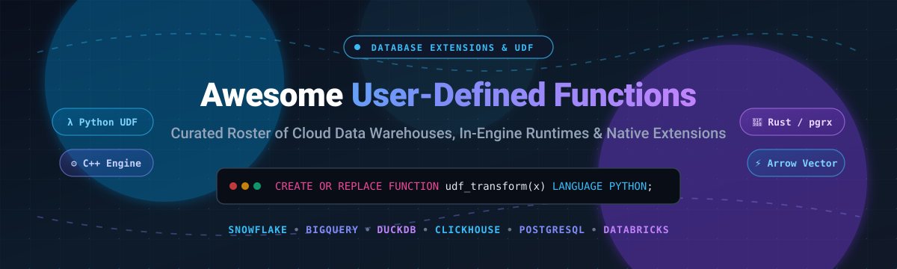

# ⚡ Awesome User-Defined Functions (UDF) & Database Extensions 🚀

  
  
  
  

  <strong>A curated catalog of premier cloud data warehouses, self-hosted analytics engines, and extension frameworks supporting User-Defined Functions (UDF), Custom Function Runtimes, Stored Procedures, and Native In-Database Execution.</strong>

---

## 📑 Table of Contents

- [🌐 Sector Overview & Market Dynamics](#-sector-overview--market-dynamics)
- [☁️ SaaS & Hosted Cloud Platforms](#️-saas--hosted-cloud-platforms)
- [🛠️ Open-Source GitHub Projects](#️-open-source-github-projects)
- [📈 Star History](#-star-history)
- [🤝 Support](#-support)
- [🤝 How to Contribute](#-how-to-contribute)
- [⚖️ Disclaimer](#️-disclaimer)

---

## 🌐 Sector Overview & Market Dynamics

The global database management systems and cloud data warehouse market is estimated at **$105+ billion in 2026** (growing at an ~18% CAGR toward $180B by 2030). The sector is **moderately concentrated among a few dominant hyperscalers and specialist giants** (Google Cloud BigQuery, AWS Redshift, Snowflake, and Databricks command over 70% of enterprise analytical query workloads), while a dynamic tier of high-performance OLAP engines (ClickHouse, SingleStore, Teradata) and embeddable open-source runtimes (DuckDB, PostgreSQL) compete aggressively for real-time analytics, modular microservices, and edge computing.

---

## ☁️ SaaS & Hosted Cloud Platforms

The following SaaS and hosted query engines provide managed, sandboxed environments for executing scalar, tabular, aggregate, or external user-defined functions in SQL, Python, Java, Scala, JavaScript, and C++.

*Sorted descending by estimated company valuation / market capitalization.*

| 🏢 Platform | 💰 Provider & Revenue / Valuation | 🏷️ Starting Tier Pricing | 🎁 Free Tier / Trial Limits | ⚙️ Supported UDF Runtimes & Key Capabilities |
| :--- | :--- | :--- | :--- | :--- |
| **[Google Cloud BigQuery](https://cloud.google.com/bigquery/docs/user-defined-functions)** | Alphabet / Google (~$2.2 Trillion Market Cap; $40B+ Google Cloud Ann. Run Rate) | **$6.25 per TB** scanned (On-Demand) or **$0.044 per edition slot-hour** (Standard Edition) | **Free Forever**: 1 TB queries/mo + 10 GB active storage/mo; New accounts get **$300 credit valid for 90 days** | SQL, JavaScript, and Python UDFs, UDAFs, and Cloud Function remote endpoints. Direct integration with PyPI packages and external VPC networks. |
| **[AWS Redshift](https://docs.aws.amazon.com/redshift/)** | Amazon / AWS (~$2.0 Trillion Market Cap; $105B+ AWS Ann. Run Rate) | **$0.25 per hour** (dc2.large on-demand cluster instance) or **$0.375 per RPU-hour** (Serverless) | **2-Month Free Trial**: 750 dc2.large node hours per month for 2 months (60 days); Free Serverless trial credit: **$300 credit over 90 days** | SQL UDFs and AWS Lambda-backed UDFs. Lambda UDFs allow invoking microservices with custom Python/Node/Java code without compute impact on Redshift. |
| **[Databricks Spark UDFs](https://docs.databricks.com/)** | Databricks ($43 Billion Valuation; $2.6B+ ARR) | **$0.07 to $0.40 per DBU** (Data Science & Engineering / All-Purpose compute tiers) | **14-Day Free Trial**: 14 days of full enterprise platform access (compute/cloud provider infrastructure billed separately) | Python, Scala, Java, and Pandas Vectorized UDFs governed by Unity Catalog; supports Apache Arrow acceleration and Variant types. |
| **[Snowflake UDFs](https://docs.snowflake.com/)** | Snowflake Inc. (~$40 Billion Market Cap; $3.6B+ ARR) | **$2.00 per Credit** (Standard Edition virtual warehouse; equates to ~$2.00/hr for X-Small warehouse) | **30-Day Free Trial**: **$400 in free usage credits** valid across a 30-day trial window | Python, SQL, JavaScript, Java, and Scala. Supports volatile scalar UDFs with dynamic table incremental refresh and partition-aware Python UDTFs. |
| **[ClickHouse Cloud](https://clickhouse.com/docs/)** | ClickHouse Inc. ($2.0 Billion Valuation) | **$0.0216 per compute unit hour** (~$15.55/month starting node minimum) | **30-Day Free Trial**: **$300 in free trial credits** valid for 30 days with no credit card required | Executable UDFs via XML/YAML configs, vector search functions, and lambda-style expressions; connects external scripts via STDIN/STDOUT stream piping. |
| **[SingleStore Helios](https://docs.singlestore.com/)** | SingleStore (~$1.3 Billion Valuation; $100M+ ARR) | **$0.65 per workspace unit (WU) hour** (Standard Cloud Helios cluster) | **$600 Free Credit**: **$600 in initial compute credits** valid for up to 30 days | Python UDFs via SingleStore Notebooks and apps runtime (`@udf`), SQL functions, C/C++ external functions, and isolated container execution. |
| **[Teradata VantageCloud](https://docs.teradata.com/)** | Teradata Corporation (~$2.8 Billion Market Cap; $1.7B+ Revenue) | **$1.85 to $3.50 per Vantage Compute Unit (VCU) hour** (Consumption model) | **30-Day Free Trial**: 30-day proof-of-concept environment pre-loaded with sample datasets and $300 cloud consumption units | SQL UDFs, External Routine Installation Tool (`tdextroutine`) for C/C++/Java runtimes, and Table UDFs with parallel execution across AMPs. |

---

## 🛠️ Open-Source GitHub Projects

Leading open-source database engines, query execution frameworks, and native extension toolkits that enable developer-defined function execution and runtimes.

*Sorted descending by GitHub stargazer count.*

| 📦 Project | ⭐ GitHub_Stars | 📜 Language / License | 🔍 Core Functionality & UDF Mechanism |
| :--- | :--- | :--- | :--- |
| **[ClickHouse](https://github.com/ClickHouse/ClickHouse)** |  | C++ / Apache-2.0 | Ultra-fast columnar OLAP engine. Implements executable script-based UDFs (Python, Shell, binaries) streaming rows via STDIN/STDOUT and SQL lambda expressions. |
| **[Apache Spark](https://github.com/apache/spark)** |  | Scala, Python / Apache-2.0 | Unified analytics engine supporting scalar UDFs, high-throughput Apache Arrow vectorized Pandas UDFs, UDAFs, and user-defined table functions (UDTFs). |
| **[DuckDB](https://github.com/duckdb/duckdb)** |  | C++ / MIT | In-process analytical engine with autoloadable extension modularity, C++ extension SDK, and native Python `create_function` bindings for custom vectorized transforms. |
| **[Apache Flink](https://github.com/apache/flink)** |  | Java, Scala / Apache-2.0 | Distributed stream processing engine offering Table & SQL API UDFs (ScalarFunction, TableFunction, AggregateFunction) in Java, Scala, and PyFlink. |
| **[TimescaleDB](https://github.com/timescale/timescaledb)** |  | C / Apache-2.0 & Timescale | Time-series and analytics extension for PostgreSQL that introduces hyperfunctions, continuous aggregates, and native time-window analytical functions. |
| **[pgvector](https://github.com/pgvector/pgvector)** |  | C / PostgreSQL License | Open-source vector similarity search extension for PostgreSQL adding custom distance operators (`<->`, `<#>`, `<=>`) and indexing types (HNSW, IVFFlat). |
| **[PostgreSQL](https://github.com/postgres/postgres)** |  | C / PostgreSQL License | Standard-bearer for database extensibility (`CREATE FUNCTION`, `CREATE EXTENSION`). Supports PL/pgSQL, PL/Python, PL/v8, and custom compiled C runtimes. |
| **[Apache Doris](https://github.com/apache/doris)** |  | C++, Java / Apache-2.0 | High-performance MPP analytical database supporting native C++ UDFs, Java UDFs, and RPC-based external user-defined functions for real-time querying. |
| **[Trino](https://github.com/trinodb/trino)** |  | Java / Apache-2.0 | Distributed SQL query engine for data lakes with a structured plugin architecture using `@ScalarFunction`, `@AggregationFunction`, and `Plugin` SPI interfaces. |
| **[Apache DataFusion](https://github.com/apache/datafusion)** |  | Rust / Apache-2.0 | Extensible query engine library written in Rust; offers native `ScalarUDF`, `AggregateUDF`, and `WindowUDF` abstractions leveraging Apache Arrow memory layouts. |
| **[Apache Calcite](https://github.com/apache/calcite)** |  | Java / Apache-2.0 | Dynamic data management framework and SQL parser featuring an extensible schema and function operator registry powering Flink, Drill, and Hive. |
| **[pgrx](https://github.com/pgcentralfoundation/pgrx)** |  | Rust / MIT & Apache-2.0 | Comprehensive framework for building safe, high-performance PostgreSQL extensions and UDFs entirely in Rust with automatic SQL generation. |
| **[PostGIS](https://github.com/postgis/postgis)** |  | C / GPL-2.0 | Geospatial database extension for PostgreSQL introducing hundreds of GIS functions, spatial predicates, geometries, and topological algorithms. |
| **[DuckDB Spatial](https://github.com/duckdb/duckdb-spatial)** |  | C++ / MIT | Geospatial UDF extension for DuckDB adding native `ST_*` geometry operations, spatial indexing, GDAL integrations, and spatial file readers. |

---

## 📈 Star History

---

## 💖 Support

Thank you for exploring this curated guide to user-defined functions and database extension runtimes! 🌟

If you found this resource helpful, please consider:
- ⭐ **Starring** the repository to support visibility
- 🍴 **Forking** and contributing additional database extension frameworks
- 📢 **Sharing** with fellow data platform architects and software engineers
- ☕ **Sponsoring or buying a coffee** via the [GitHub Sponsors Dashboard](https://github.com/sponsors/ishandutta2007) to power ongoing open-source maintenance!

---

## 🤝 How to Contribute

Contributions are welcome! Please follow these guidelines:

1. 🍴 Fork the repository.
2. ✍️ Add your tool to either the **SaaS & Hosted Cloud Platforms** table or **Open-Source GitHub Projects** table maintaining sorted order:
   - SaaS platforms sorted by company valuation / revenue descending.
   - Open-source tools sorted by GitHub Stars_Count descending, including the white social Stars_Badge linked to the repo's stargazers page.
3. 🔎 Ensure specific pricing tiers, free trial details, or licensing terms are factual and cited.
4. 🚀 Submit a Pull Request with a clear description of the project.

---

## ⚖️ Disclaimer

- 📌 This list is community-curated for informational purposes and does not represent an endorsement.
- 🔒 User-Defined Functions execute arbitrary logic inside or adjacent to query execution environments; always audit sandboxing, network isolation, permissions, and memory bounds before deploying UDFs in production environments.
- 💡 Product pricing, free tier terms, and feature capabilities change over time. Verify details on the respective vendor or project websites.

---

  Curated with precision for data engineers, analytics architects, and database systems developers.

